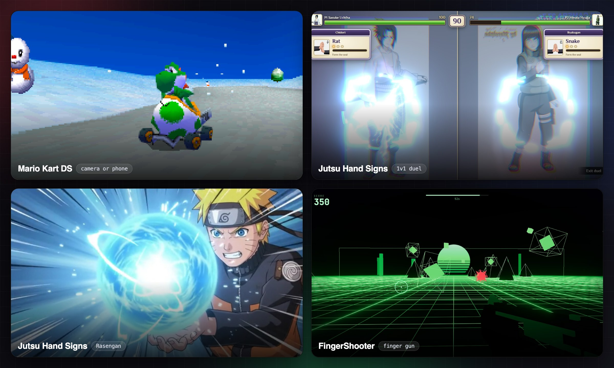

<p align="center">
  
</p>

<p align="center">
  <a href="https://github.com/MicroClub-USTHB/mc-Motion-Games/stargazers"></a>
  <a href="https://github.com/MicroClub-USTHB/mc-Motion-Games/issues"></a>
  <a href="https://github.com/MicroClub-USTHB/mc-Motion-Games/commits/main"></a>
  <a href="https://github.com/MicroClub-USTHB"></a>
</p>

<p align="center"><a href="#the-games">Games</a> · <a href="#run-them">Run them</a> · <a href="#how-to-play">How to play</a> · <a href="#built-with">Built with</a> · <a href="#contributors">Contributors</a></p>

---

<p align="center">
  
</p>

<p align="center"><sub>Real captures: Mario Kart DS (DS64), the Jutsu duel and Rasengan intro, FingerShooter.</sub></p>

## Motion Games

Interactive camera-detection games for university open days. Control the game with
hand gestures, body movements and facial expressions using OpenCV and MediaPipe.
No controllers, no setup for the player: walk up, stand in front of the camera, play.

## The games

<table>
<tr>
<td width="33%" valign="top">

### Mario Kart DS, webcam edition

Play Mario Kart DS with your hands or your phone.

- Webcam gesture steering
- Phone touch controller (wheel, buttons or gyroscope)
- Up to 4-player local multiplayer, one window
- A melonDS fork

**[Open the repo](https://github.com/MicroClub-USTHB/mario-cam-kart)** · `submodules/mario-cam-kart`

</td>
<td width="33%" valign="top">

### Jutsu Hand Signs, Naruto webcam game

Choose your ninja and form the hand seals.

- Rasengan and Chidori, drawn live on your hand
- Rule-based hand-sign recognition
- Easy, Medium and Hard
- 1v1 duel in 3D with Three.js

**[Open the repo](https://github.com/MicroClub-USTHB/JutsuHandSigns)** · `submodules/jutsu-hand-signs`

</td>
<td width="33%" valign="top">

### FingerShooter, finger-gun gallery

Aim with your index finger, fire by snapping your thumb.

- Matrix-style 3D shooting gallery in the browser
- Hand tracking runs fully in-browser, nothing uploaded
- Combo multiplier, 60-second rounds
- Mouse fallback if the camera is blocked

**[Open the repo](https://github.com/MicroClub-USTHB/FingerShooter)** · [Play live](https://fingershooter.netlify.app/) · `submodules/fingershooter`

</td>
</tr>
</table>

## Run them

```bash
git clone --recurse-submodules https://github.com/MicroClub-USTHB/mc-Motion-Games.git
cd mc-Motion-Games      # already cloned? git submodule update --init --recursive
```

Each game has its own README with install steps and requirements. Quick start:

```bash
# Jutsu Hand Signs
cd submodules/jutsu-hand-signs && pip install -r requirements.txt && python main.py

# FingerShooter (runs in the browser)
cd submodules/fingershooter && npm install && npm run dev

# Mario Kart DS (needs your own legally dumped ROM, see its README)
cd submodules/mario-cam-kart && ./play.sh      # play.bat on Windows
```

## How to play

| Game | Steps |
| --- | --- |
| **Mario Kart DS** | Show both hands to the camera and grab an imaginary wheel. Tilt to steer, fist to accelerate, open palm to brake, thumb out for an item. Or scan the QR code and drive from your phone. |
| **Jutsu Hand Signs** | Pick a ninja and difficulty. Form each seal shown on screen and hold it. Finish the sequence and your jutsu erupts on your hand. |
| **FingerShooter** | Allow the camera, hold the aim pose until calibration fills. Point your index finger to aim, cock and snap your thumb to fire. Avoid the firewall viruses. |

## Built with

| | |
| --- | --- |
| **OpenCV** | camera capture and the particle effects |
| **MediaPipe** | hand tracking and gesture recognition |
| **Python** | game logic |
| **Three.js** | the 3D scene of FingerShooter and the Jutsu duel |
| **melonDS** | the Nintendo DS emulator the kart game is forked from |

## Contributors

The people who built these games.

<table>
<tr>
<td align="center" valign="top" width="16%">
<a href="https://github.com/wailbentafat"></a><br />
<a href="https://github.com/wailbentafat"><b>bentafat wail</b></a><br />
<sub>Mario Kart · Jutsu · FingerShooter</sub>
</td>
<td align="center" valign="top" width="16%">
<a href="https://github.com/nisbenz"></a><br />
<a href="https://github.com/nisbenz"><b>Nisbenz</b></a><br />
<sub>Mario Kart · Jutsu</sub>
</td>
<td align="center" valign="top" width="16%">
<a href="https://github.com/Abadli-Badro"></a><br />
<a href="https://github.com/Abadli-Badro"><b>Abadli Badreddine</b></a><br />
<sub>FingerShooter</sub>
</td>
<td align="center" valign="top" width="16%">
<a href="https://github.com/trrayane"></a><br />
<a href="https://github.com/trrayane"><b>tr_rayane</b></a><br />
<sub>Jutsu</sub>
</td>
<td align="center" valign="top" width="16%">
<a href="https://github.com/MohamedTouaa"></a><br />
<a href="https://github.com/MohamedTouaa"><b>Shiroyasha</b></a><br />
<sub>Jutsu</sub>
</td>
<td align="center" valign="top" width="16%">
<a href="https://github.com/leash06"></a><br />
<a href="https://github.com/leash06"><b>leash06</b></a><br />
<sub>Motion Games</sub>
</td>
</tr>
</table>

## License and legal

Each game carries its own license, see its repository. Mario Kart DS is an independent fan
project, not affiliated with Nintendo; only play games you own. The Jutsu game is a fan project
inspired by Naruto.

## Acknowledgements

[melonDS](https://github.com/melonDS-emu/melonDS) · [MediaPipe](https://mediapipe.dev/) · [OpenCV](https://opencv.org/)
